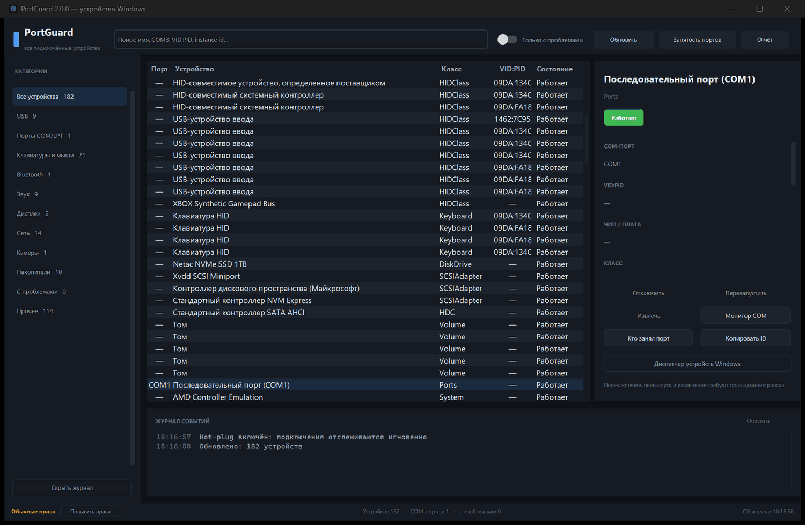
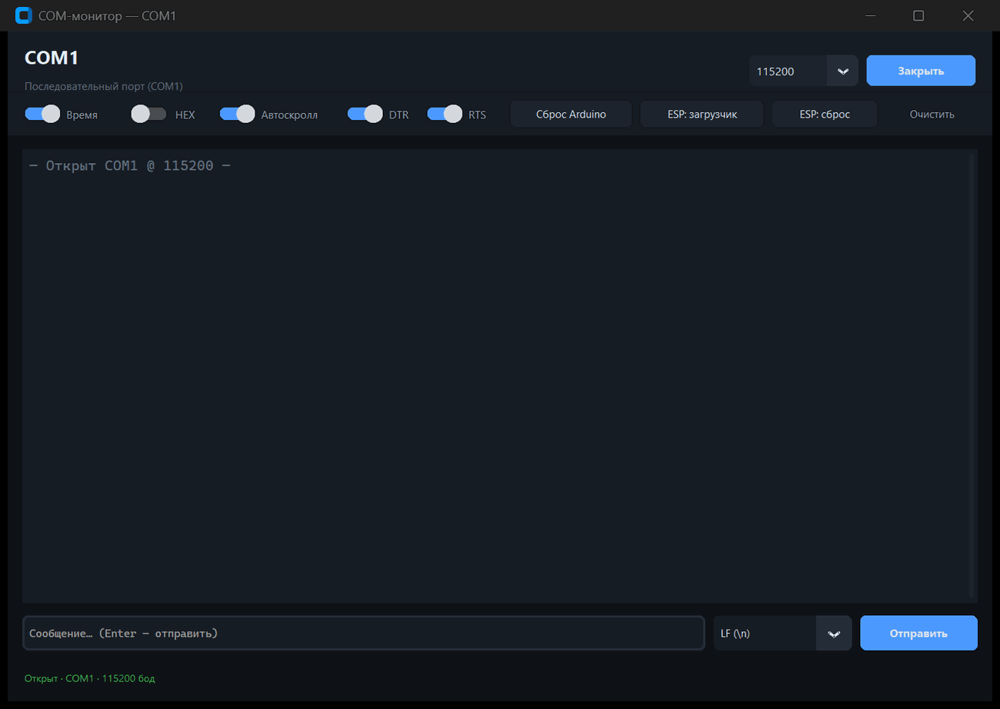
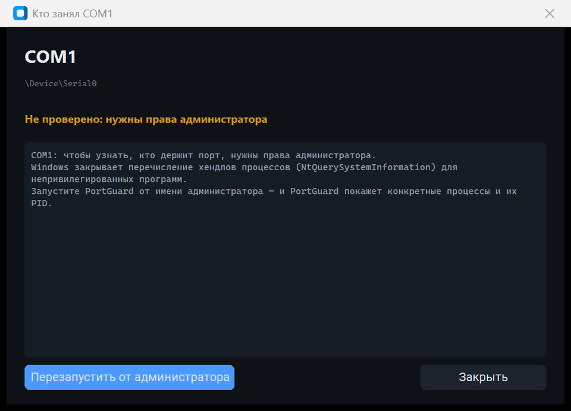

# PortGuard

**Менеджер всех подключённых устройств Windows.** Показывает USB, COM-порты, HID,
Bluetooth, звук, дисплеи, камеры и накопители — с VID/PID, драйвером, состоянием и
расположением. Позволяет включать, отключать, перезапускать и безопасно извлекать
устройства, следит за подключением в реальном времени и отвечает на вопрос, который
Windows обычно игнорирует: **какая программа заняла COM-порт**.


---

## Возможности

- **Все устройства системы**, а не только COM-порты: дерево PnP через SetupAPI,
  включая устройства без драйвера и отключённые.
- **Карточка устройства**: имя, класс, производитель, версия драйвера, расположение
  на шине, hardware/compatible ID, instance ID, родительское устройство.
- **VID:PID и определение чипа**: CH340/CH341, CH9102, CP2102/CP210x, FT232/FT231,
  PL2303, ESP32-S2/S3 (USB Serial/JTAG), Raspberry Pi Pico, STM32, Arduino
  Uno/Mega/Leonardo/Micro, SEGGER J-Link.
- **Состояние и коды проблем**: «работает», «отключено», «остановлено»,
  «ошибка 10/28/43/52…» с человеческой формулировкой причины.
- **Управление**: включить, отключить, перезапустить, безопасно извлечь
  (`CM_Request_Device_EjectW` с разбором причины отказа).
- **Hot-plug в реальном времени**: `WM_DEVICECHANGE`, без опроса раз в секунду —
  подключили флешку, и строка появилась сразу; в журнале видно `+` и `−`.
- **Кто занял COM-порт**: перечисление хендлов процессов, сопоставление
  `COM3 → \Device\Serial0`, имя процесса, PID и путь к exe. Порт при этом
  **не открывается**, поэтому Arduino/ESP не перезагружаются.
- **COM-терминал**: скорость, HEX приём и отправка, метки времени, автоскролл,
  управление DTR/RTS, импульс сброса Arduino и последовательности
  «ESP: загрузчик» / «ESP: сброс».
- **Отчёт**: экспорт всех устройств в JSON или CSV (CSV с `;` и BOM — открывается
  в Excel без пляски с кодировками).
- **CLI** для диагностики и скриптов: `list`, `ports`, `holders`, `action`, `monitor`,
  поддержка `--json`.
- Тёмная тема, русский интерфейс, поиск по имени/COM/VID:PID/классу, сортировка
  по колонкам, категории и счётчики.

## Скриншоты

Главное окно: таблица устройств, категории, карточка COM1 и журнал событий.



COM-терминал: HEX, метки времени, управление линиями и сбросом платы.



Ответ на вопрос «кто занял порт» — с честным сообщением, если прав не хватает.



## Установка

### Готовая сборка

1. Скачайте архив из раздела **Releases** (или возьмите папку `dist\PortGuard` после
   сборки).
2. Запустите `PortGuard.exe` — это графическое приложение без консольного окна.
3. Для команд в терминале используйте `PortGuardCLI.exe`.

Для управления устройствами и поиска держателей портов нужны права администратора:
Windows отдаёт эти данные только привилегированным процессам. В приложении есть
кнопка **«Повысить права»** — она перезапускает PortGuard через UAC.

### Из исходников

```powershell
git clone https://github.com/hardkor88/PortGuard.git
cd PortGuard
python -m venv .venv
.\.venv\Scripts\Activate.ps1
pip install -r requirements.txt
python main.py
```

Требования: Windows 10/11 x64 и Python 3.10+. Сторонних бинарников и pywin32 не
нужно: весь Win32 API подключён через `ctypes`.

## Командная строка

```text
python -m portguard                      # графическое приложение
python -m portguard list                 # таблица всех устройств
python -m portguard list --problems      # только проблемные
python -m portguard list --json          # машиночитаемый отчёт
python -m portguard ports                # только COM-порты
python -m portguard ports --json
python -m portguard holders COM3         # кто занял порт (нужен админ)
python -m portguard action disable "USB\VID_1A86&PID_7523\5&2A3B4C&0&1"
python -m portguard action enable|restart|eject <instance_id>
python -m portguard monitor COM3 --baud 115200
```

Пример вывода `ports`:

```text
COM1  Последовательный порт (COM1)
        (Стандартные порты)
          ·  Работает
```

Пример `holders` без прав администратора:

```text
COM1: чтобы узнать, кто держит порт, нужны права администратора.
Windows закрывает перечисление хендлов процессов (NtQuerySystemInformation)
для непривилегированных программ.
```

## Почему нужны права администратора

| Действие | Без админа | С админом |
|---|---|---|
| Список устройств, свойства, VID/PID | да | да |
| Включить / отключить / перезапустить | нет | да |
| Безопасное извлечение | нет | да |
| Кто занял COM-порт | нет | да |
| COM-терминал (если порт свободен) | да | да |

Это ограничение Windows, а не приложения. PortGuard не обходит его и не притворяется,
что «нашёл виновника», перебирая имена процессов: без прав он честно сообщает, что
данных нет, и предлагает перезапуск с повышением.

## Как это устроено

- **`portguard/core/winapi.py`** — объявления Win32 через `ctypes`: SetupAPI,
  Configuration Manager, kernel32/advapi32, user32, ntdll.
- **`setupapi.py`** — перечисление `SetupDiGetClassDevsW(DIGCF_ALLCLASSES|DIGCF_PRESENT)`,
  свойства `SetupDiGetDeviceRegistryPropertyW` и `SetupDiGetDevicePropertyW`,
  состояние `CM_Get_DevNode_Status`, действия `DIF_PROPERTYCHANGE` и
  `CM_Request_Device_EjectW`, имя порта из `Device Parameters\PortName`.
- **`holders.py`** — `NtQuerySystemInformation(SystemExtendedHandleInformation)`,
  `DuplicateHandle` в свой процесс, `NtQueryObject` для типа и имени объекта,
  `SeDebugPrivilege`. Скан идёт в отдельном потоке с таймаутом: `NtQueryObject`
  умеет зависать на некоторых объектах, и интерфейс не должен из-за этого вставать.
- **`hotplug.py`** — невидимое окно верхнего уровня и `WM_DEVICECHANGE`
  (`DBT_DEVNODES_CHANGED`). Регистрировать интерфейсы не нужно, сообщение
  широковещательное; серия событий схлопывается дебаунсом 350 мс.
- **`serial_monitor.py`** — pyserial, поток чтения, колбэки, счётчики, DTR/RTS и
  последовательности сброса ESP32 из esptool.
- **`ui/`** — customtkinter: тёмная тема, Treeview на 200+ строк, панель деталей,
  журнал, COM-терминал, диалог держателей порта.

Отдельно про «занятость» порта: типовой способ — открыть порт и посмотреть, не
ошибка ли. Так делать нельзя: открытие COM-порта дёргает DTR/RTS и перезагружает
плату, а «монитор», который проверяет порт каждые 1.5 секунды, превращает Arduino
в мигающую ёлочку. PortGuard определяет занятость по хендлам и порт не трогает.

## Ограничения

- Только Windows 10/11 x64. Linux и macOS не поддерживаются.
- PortGuard **не** устанавливает драйверы, **не** удаляет устройства и **не**
  завершает процессы. Он показывает, кто держит порт, — закрывать программу или нет,
  решает пользователь.
- Некоторые устройства не отдают часть свойств (например, VID/PID у встроенных
  портов или версию драйвера у виртуальных шин) — такие поля показывают «—».
- Права администратора нужны для действий и поиска держателей портов (см. таблицу).
- Проверялось на Windows 11 24H2: 182 устройства, COM1, USB-периферия. На другой
  конфигурации список устройств будет другим — это нормально.

## Сборка

```powershell
# один раз
pip install pyinstaller pillow

# сборка: dist\PortGuard\PortGuard.exe (GUI) + PortGuardCLI.exe (консоль)
powershell -ExecutionPolicy Bypass -File .\build.ps1

# пересборка начисто
powershell -ExecutionPolicy Bypass -File .\build.ps1 -Clean
```

Либо двойной клик по `build.cmd`. Иконка рисуется кодом в `tools/make_icon.py`,
поэтому в репозитории нет бинарника неизвестного происхождения.

## Тесты

```powershell
python -m unittest discover -s tests -v
```

37 тестов: разбор VID/PID и serial, статусы и коды проблем, категории, определение
чипов, сводки, экспорт JSON/CSV, разбор буфера хендлов, чтение `UNICODE_STRING`,
быстрый возврат сканера портов.

## Структура проекта

```text
PortGuard/
├─ main.py                 запуск из исходников
├─ PortGuard.spec          сборка двух exe (GUI + CLI)
├─ build.ps1 / build.cmd   сборка дистрибутива
├─ requirements.txt
├─ pyproject.toml
├─ portguard/
│  ├─ cli.py               команды list/ports/holders/action/monitor
│  ├─ core/
│  │  ├─ winapi.py         объявления Win32 (ctypes)
│  │  ├─ setupapi.py       перечисление, свойства, действия
│  │  ├─ model.py          Device, категории, VID/PID, коды проблем
│  │  ├─ holders.py        кто занял COM-порт
│  │  ├─ hotplug.py        WM_DEVICECHANGE
│  │  ├─ serial_monitor.py COM-терминал и сброс плат
│  │  ├─ elevation.py      проверка прав и перезапуск через UAC
│  │  └─ report.py         экспорт JSON/CSV
│  └─ ui/                  окно, таблица, детали, монитор
├─ tools/make_icon.py      генератор иконки
├─ tests/                  37 unit-тестов
├─ assets/                 иконка
└─ media/                  скриншоты для README
```

## Лицензия

MIT — см. [LICENSE](LICENSE).

Проект написан с помощью DeepSeek: код, тесты и документация созданы в паре
«человек + модель», архитектура и решения — предмет обсуждения в коммитах.
